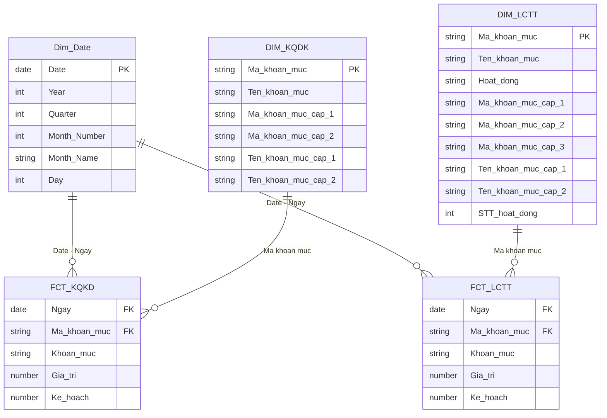

# Financial Analytics — Performance & Cash Flow

**Dự án Power BI | Phân tích kết quả kinh doanh, chênh lệch kế hoạch và dòng tiền giai đoạn 2024–2025**

> **Tổng quan dự án:** Đây là dự án sử dụng **Power BI** để xây dựng báo cáo phân tích tài chính, theo dõi **kết quả kinh doanh**, **mức độ thực hiện kế hoạch** và **biến động dòng tiền** trong giai đoạn **2024–2025**. Mục tiêu là hỗ trợ người dùng nhanh chóng phát hiện các vấn đề nổi bật như doanh thu suy giảm, biên lợi nhuận thu hẹp, áp lực dòng tiền và các khoản mục lệch kế hoạch cần ưu tiên rà soát.

**Công cụ sử dụng:** `Power BI` · `Power Query (M)` · `DAX` · `Excel` · `Dimensional Data Modeling`

**Phạm vi dự án:** **4** trang dashboard tương tác · **2** bảng fact · **3** bảng dimension · dữ liệu tài chính **2024–2025**

---

## 1. Bài toán kinh doanh

Trong thực tế, chỉ nhìn vào doanh thu hay lợi nhuận là chưa đủ để đánh giá toàn diện hiệu quả hoạt động của doanh nghiệp. Doanh nghiệp còn cần biết:

- Doanh thu và lợi nhuận đang biến động như thế nào theo thời gian.
- Khoản mục nào đang lệch nhiều so với kế hoạch.
- Tiền đang được tạo ra từ đâu, chi vào đâu và có rủi ro gì về dòng tiền.

Ngoài ra, dữ liệu tài chính thường nằm rải rác ở nhiều tệp Excel khác nhau, gây khó khăn cho việc theo dõi tập trung, so sánh giữa các kỳ và phát hiện vấn đề nhanh chóng.

### Dự án này tập trung trả lời 3 câu hỏi chính:

1. **Hiệu quả kinh doanh:** Doanh thu, chi phí và lợi nhuận thay đổi ra sao theo từng kỳ?
2. **Kiểm soát kế hoạch:** Khoản mục nào đang vượt hoặc hụt kế hoạch nhiều nhất?
3. **Dòng tiền:** Tiền đến từ hoạt động nào, được sử dụng vào đâu và có dấu hiệu rủi ro hay không?

**Cách tiếp cận phân tích:**

`Business Problem → Data Preparation → Data Model → Dashboard → Insight → Recommendation`

---

## 2. Tổng quan dữ liệu

Dự án sử dụng **6 tệp Excel nguồn**, được chia thành 3 nhóm chính:

| Nhóm dữ liệu | Tệp nguồn | Phạm vi | Số dòng fact |
|---|---|---|---:|
| Kết quả kinh doanh (KQKD) | `KQKD 2024.xlsx`, `KQKD 2025.xlsx` | Tháng 01–11 của từng năm | 506 |
| Lưu chuyển tiền tệ (LCTT) | `Dòng tiền 2024.xlsx`, `Dòng tiền 2025.xlsx` | Từ 01/2024 đến 12/2025 | 408 |
| Danh mục khoản mục | `Danh mục KQKD.xlsx`, `Danh mục LCTT.xlsx` | Mã khoản mục, tên khoản mục, phân cấp báo cáo | — |

Tổng cộng, hai bảng fact có **914 dòng dữ liệu**, bao gồm **giá trị thực tế** và **giá trị kế hoạch** theo từng kỳ và từng khoản mục tài chính.

### Lưu ý phạm vi dữ liệu

- Dữ liệu **KQKD** chỉ có từ **tháng 01 đến tháng 11** của mỗi năm, nên các so sánh được thực hiện theo **cùng kỳ**.
- Dữ liệu **LCTT** có đủ **12 tháng** cho cả năm 2024 và 2025.
- Các số liệu tổng hợp trong phần insight được trình bày theo đơn vị **triệu đồng**.

---

## 3. Xử lý và mô hình hóa dữ liệu

### 3.1. Làm sạch dữ liệu bằng Power Query

Các bước xử lý chính gồm:

- Gộp các tệp Excel theo từng nghiệp vụ thành hai bảng fact riêng cho **KQKD** và **LCTT**.
- Chuẩn hóa kiểu dữ liệu cho các cột: ngày, mã khoản mục, tên khoản mục, giá trị thực tế và kế hoạch.
- Làm sạch văn bản bằng các thao tác như `Trim`, `Clean`.
- Chuẩn hóa mã khoản mục ngắn bằng `Text.PadStart` để đảm bảo tính nhất quán khi liên kết dữ liệu.
- Kiểm tra lỗi và giá trị trống ở các cột chính.
- Giữ đúng cấu trúc phân cấp khoản mục để tránh cộng chồng giữa dòng tổng hợp và dòng chi tiết.

### 3.2. Mô hình dữ liệu

Mô hình dữ liệu của báo cáo sử dụng **2 bảng fact kết nối với 3 bảng dimension**, trong đó dimension thời gian được dùng chung cho hai nghiệp vụ, gồm:

- **2 bảng fact:** `FCT_KQKD`, `FCT_LCTT`
- **3 bảng dimension:** `Dim_Date`, `DIM_KQDK`, `DIM_LCTT`

Các quan hệ chính là **1-nhiều** từ dimension đến fact.

### Sơ đồ mô hình dữ liệu

Sơ đồ dưới đây được viết bằng **Mermaid**, nên **hiển thị trực tiếp trên GitHub ngay trong file `README.md`**, không cần lưu thêm ảnh. Mỗi bảng thể hiện các trường chính; các đường nối mô tả khóa liên kết và quan hệ **một–nhiều (1:N)**.

**Giải thích mô hình:**

| Bảng | Vai trò | Nội dung chính |
|---|---|---|
| `Dim_Date` | Dimension thời gian dùng chung | Ngày, tháng, quý, năm; phục vụ lọc và so sánh theo kỳ |
| `DIM_KQDK` | Dimension danh mục KQKD | Mã khoản mục, tên và phân cấp khoản mục để drill-down |
| `DIM_LCTT` | Dimension danh mục LCTT | Mã khoản mục, phân cấp và nhóm hoạt động dòng tiền |
| `FCT_KQKD` | Fact kết quả kinh doanh (**506 dòng, 22 kỳ**) | Giá trị thực tế và kế hoạch của doanh thu, chi phí, lợi nhuận |
| `FCT_LCTT` | Fact lưu chuyển tiền tệ (**408 dòng, 24 kỳ**) | Giá trị thực tế và kế hoạch của các khoản thu, chi, dòng tiền |

**Quan hệ:** `Dim_Date[Date]` kết nối với cột `Ngày` của cả hai fact; mỗi dimension danh mục kết nối với fact tương ứng qua `Mã khoản mục`. Các quan hệ chính là **1:N**, hướng lọc **dimension → fact**. Các dòng tổng hợp và chi tiết cần được tính theo đúng cấp khoản mục để tránh cộng chồng khi tạo KPI.

### 3.3. DAX và logic phân tích

DAX được sử dụng để hỗ trợ:

- Tính các KPI tài chính chính.
- So sánh **Thực tế vs Kế hoạch**.
- So sánh với **kỳ trước**.
- Tính các chỉ số biên lợi nhuận.
- Đánh giá hiệu quả dòng tiền theo từng hoạt động.

### 3.4. Quy trình thực hiện tổng quát

---

## 4. Tổng quan dashboard

Báo cáo Power BI gồm **4 trang dashboard tương tác**, cho phép lọc theo **Năm** và **Tháng**, kết hợp giữa KPI, biểu đồ xu hướng và bảng chi tiết.

| Trang | Mục đích | Thành phần chính |
|---|---|---|
| **01 · Kế hoạch dòng tiền** | Theo dõi mức độ thực hiện kế hoạch thu, chi và lưu chuyển tiền thuần | KPI cards, biểu đồ thực tế vs kế hoạch, cơ cấu theo hoạt động, bảng chi tiết, top khoản mục lệch kế hoạch |
| **02 · Biến động dòng tiền** | Phân tích dòng tiền từ hoạt động kinh doanh, đầu tư và tài chính | KPI so sánh kỳ, biểu đồ biến động dòng tiền, tỷ lệ dòng tiền/doanh thu, matrix drill-down |
| **03 · Kết quả kinh doanh** | Đánh giá doanh thu, giá vốn, lợi nhuận gộp và lợi nhuận sau thuế | KPI tài chính, xu hướng theo tháng, phân tích biên lợi nhuận, bảng đối chiếu khoản mục |
| **04 · Chi tiết thực hiện KQKD** | Đi sâu vào chênh lệch thực tế, kỳ trước và kế hoạch theo từng khoản mục | Matrix phân cấp, chỉ báo tăng/giảm, định dạng điều kiện |

### Ví dụ tại tháng 08/2025

- **Tiền thu** đạt **102,38%** kế hoạch.
- **Tiền chi** đạt **105,30%** kế hoạch.
- Cần lưu ý rằng với khoản mục chi phí hoặc chi tiền, tỷ lệ vượt 100% **không phải lúc nào cũng là tín hiệu tích cực**.
---

## 5. Insight nổi bật: Vấn đề → Phân tích → Hướng xử lý

Các insight dưới đây được rút ra từ báo cáo dự án. Phần “hướng xử lý” là **đề xuất phân tích/ra quyết định**, không phải kết quả đã được doanh nghiệp triển khai.

| Vấn đề | Insight / Phát hiện | Hướng xử lý đề xuất |
|---|---|---|
| **Doanh thu không đạt kế hoạch** | Doanh thu bán hàng 11 tháng năm 2025 giảm **18,33%** so với cùng kỳ và chỉ đạt khoảng **92,65%** kế hoạch. Mức hụt lũy kế khoảng **4.115,2 triệu đồng**. | Xếp hạng các tháng hụt kế hoạch lớn nhất, sau đó kiểm tra sản lượng, giá bán và kênh bán nếu có dữ liệu bổ sung. |
| **Biên lợi nhuận gộp bị thu hẹp** | Doanh thu thuần giảm **18,74%**, trong khi giá vốn tăng **4,23%**. Biên lợi nhuận gộp giảm từ **73,72% xuống 66,29%** (giảm **7,43 điểm %**). | Phân rã biến động giá vốn theo nguyên liệu, bao bì và các chi phí thành phần; kiểm tra đơn giá và cơ cấu sản phẩm nếu có dữ liệu hỗ trợ. |
| **Tiết giảm chi phí chưa bù được mức giảm lợi nhuận** | Chi phí vận hành giảm **2.595,8 triệu đồng**, nhưng lợi nhuận gộp giảm tới **12.545,2 triệu đồng**. Lợi nhuận sau thuế chỉ đạt khoảng **85,54%** kế hoạch. | Lập bảng phân rã chênh lệch lợi nhuận theo doanh thu thuần, giá vốn, chi phí vận hành và thuế. |
| **Khả năng tạo tiền từ kinh doanh suy giảm** | Dòng tiền từ hoạt động kinh doanh giảm **72,44%** so với năm 2024, từ **17.942,8 triệu** xuống còn **4.945,9 triệu đồng**. | Theo dõi thu – chi hoạt động kinh doanh theo tháng; nếu có thể, bổ sung dữ liệu công nợ phải thu/phải trả để phân tích sâu hơn. |
| **Cần kiểm tra lại tính nhất quán số dư tiền** | Dòng tiền thuần năm 2025 chỉ dương **178,6 triệu đồng**. Tuy nhiên, số dư cuối năm 2024 (**14.850,1 triệu đồng**) không khớp với số dư đầu năm 2025 (**19,8 triệu đồng**) trong dữ liệu nguồn. | Xác minh lại số dư đầu kỳ và phạm vi dữ liệu nguồn trước khi kết luận về biến động tiền mặt giữa hai năm. |

### Một số chỉ tiêu tài chính tiêu biểu

| Chỉ tiêu | 2024 | 2025 | Phạm vi so sánh |
|---|---:|---:|---|
| Doanh thu bán hàng | 63.512,4 | 51.873,5 | 01–11; triệu đồng |
| Doanh thu thuần | 63.212,8 | 51.369,5 | 01–11; triệu đồng |
| Lợi nhuận gộp | 46.599,4 | 34.054,2 | 01–11; triệu đồng |
| Lợi nhuận sau thuế | 32.446,5 | 22.484,1 | 01–11; triệu đồng |
| Biên lợi nhuận gộp | 73,72% | 66,29% | 01–11 |
| Dòng tiền từ HĐKD | 17.942,8 | 4.945,9 | Cả năm; triệu đồng |
| Lưu chuyển tiền thuần | 14.830,3 | 178,6 | Cả năm; triệu đồng |

---

## 6. Hạn chế hiện tại và hướng phát triển

### Hạn chế hiện tại

- **Thiếu dữ liệu tháng 12 cho KQKD:** Do đó, so sánh kỳ trước cho tháng 01/2025 không thể phản ánh đầy đủ.
- **Số dư tiền chưa khớp giữa hai năm:** Cần đối soát lại dữ liệu nguồn trước khi diễn giải biến động tiền mặt.
- **Thiếu dữ liệu chi tiết để phân tích nguyên nhân gốc:** Chưa có dữ liệu mức giao dịch về sản lượng, đơn giá, kênh bán, công nợ, cấu phần giá vốn… nên chưa thể kết luận sâu về nguyên nhân kinh doanh.

### Hướng phát triển

- Bổ sung dữ liệu giao dịch bán hàng để phân tích **price – volume – mix**.
- Bổ sung dữ liệu công nợ phải thu/phải trả để dự báo và quản trị dòng tiền tốt hơn.
- Tạo các rule kiểm tra chất lượng dữ liệu như đối chiếu số dư đầu kỳ – cuối kỳ.
- Export toàn bộ dashboard thành ảnh để tăng tính trực quan trên GitHub.
- Bổ sung data dictionary ngắn gọn cho các bảng và measure quan trọng.

